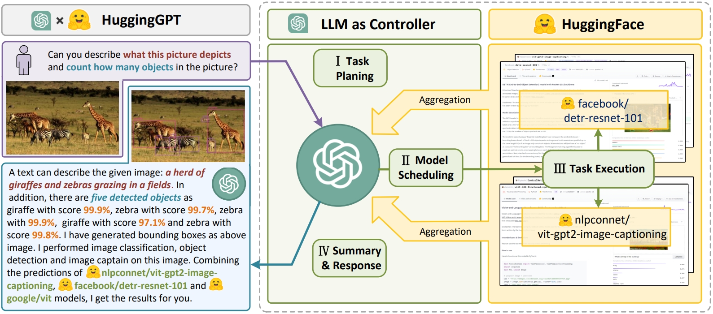
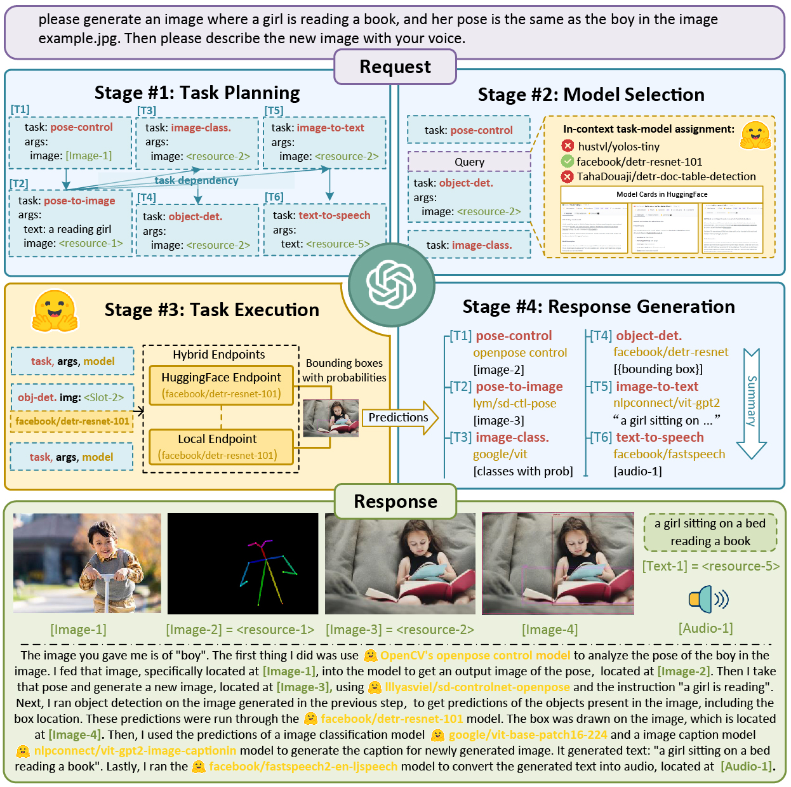
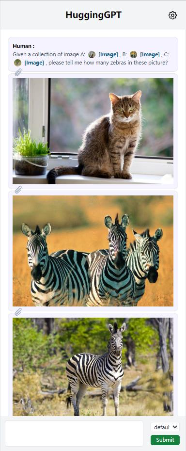
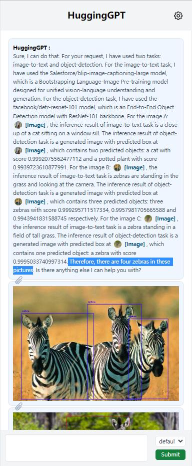

<p align="center">
  <a href="README.md">English</a> · <b>简体中文</b>
</p>

# JARVIS

[](https://arxiv.org/abs/2303.17580)
[](https://huggingface.co/spaces/microsoft/HuggingGPT)

**JARVIS** 的使命是探索通用人工智能（AGI），并向全球开发者与学术社区交付前沿研究成果。

## 最新动态 (What's New)

+  [2024.01.15] 发布 EasyTool，提供更便捷高效的工具调用能力。
   + 代码与数据集可访问 [EasyTool](/easytool)。
   + 论文可访问 [EasyTool: Enhancing LLM-based Agents with Concise Tool Instruction](https://arxiv.org/abs/2401.06201)。
+  [2023.11.30] 发布 TaskBench，用于评估大语言模型的任务自动化能力。
   + 代码与数据集可访问 [TaskBench](/taskbench)。
   + 论文可访问 [TaskBench: Benchmarking Large Language Models for Task Automation](https://arxiv.org/abs/2311.18760)。
+  [2023.07.28] 当前正处于评估规划与项目重构阶段，将在近期发布新版 Jarvis。
+  [2023.07.24] 发布轻量级 LangChain 版本 Jarvis，详见<a href="https://github.com/langchain-ai/langchain/tree/master/libs/experimental/langchain_experimental/autonomous_agents/hugginggpt">此处</a>。
+  [2023.04.16] Jarvis 现已支持 Azure 平台的 OpenAI 服务以及 GPT-4 模型。
+  [2023.04.06] 新增 Gradio 演示，并在 `server` 模式下为 `/tasks` 和 `/results` 构建了 Web API。
   + Gradio 演示已托管在 Hugging Face Space 上（采用 `inference_mode=hybrid` 和 `local_deployment=standard` 构建）。
   + Web API `/tasks` 与 `/results` 可访问 `第一阶段`（任务规划）以及 `第一至第三阶段`（带有执行结果的模型选择）的中间结果，详见<a href="#Server">服务端说明</a>。
+  [2023.04.03] 新增 CLI 命令行模式，并提供用于配置本地端点规模的参数。
   + 无需在本地部署模型即可体验轻量化的 Jarvis，详见<a href="#Configuration">配置说明</a>。
   + 只需运行 `python awesome_chat.py --config configs/config.lite.yaml` 即可体验。
+  [2023.04.01] 更新了一版用于构建的代码。


### 项目概览 (Overview)

语言是大语言模型连接众多专有 AI 模型以解决复杂多模态任务的通用接口！

<p align="center">
    
</p>

论文详见：[HuggingGPT: Solving AI Tasks with ChatGPT and its Friends in HuggingFace](http://arxiv.org/abs/2303.17580)，作者：沈永亮、宋凯涛、谭旭、李东胜、卢为民、庄越挺（前两位作者贡献相同）。

我们提出了一个协同系统架构，由**作为控制器（Controller）的 LLM** 和**作为协同执行者（Executors）的众多专家模型**（来自 Hugging Face Hub）共同构成。系统的工作流程分为四个阶段：
+ **任务规划 (Task Planning)**：利用 ChatGPT 分析用户的输入请求以理解其意图，并将其拆解为若干可求解的子任务。
+ **模型选择 (Model Selection)**：针对规划好的每个子任务，ChatGPT 根据模型描述从 Hugging Face 托管的专家模型中选择匹配的模型。
+ **任务执行 (Task Execution)**：调用并执行选中的各个专家模型，并将中间结果汇总返回给 ChatGPT。
+ **响应生成 (Response Generation)**：最后由 ChatGPT 整合所有专家模型的预测输出，为用户生成连贯友好的最终回复。

<p align="center"></p>

### 系统要求 (System Requirements)

#### 默认配置 (Default，推荐)

针对 `configs/config.default.yaml`：

+ Ubuntu 16.04 LTS
+ 显存 (VRAM) >= 24GB
+ 内存 (RAM) > 12GB (极简模式 minimal)，16GB (标准模式 standard)，80GB (完整模式 full)
+ 磁盘空间 > 284GB 
  + 42GB 用于 `damo-vilab/text-to-video-ms-1.7b`
  + 126GB 用于 `ControlNet`
  + 66GB 用于 `stable-diffusion-v1-5`
  + 50GB 用于其他模型
  
#### 最低配置 (Lite，轻量版)

针对 `configs/config.lite.yaml`：

+ Ubuntu 16.04 LTS
+ 无其他硬件门槛

`configs/config.lite.yaml` 配置无需在本地下载或部署任何专家模型。但这意味 Jarvis 将完全受限于在 Hugging Face Inference Endpoints 上稳定运行的在线模型。

### 快速开始 (Quick Start)

首先将 `server/configs/config.default.yaml` 中的 `openai.key` 和 `huggingface.token` 替换为**您个人的 OpenAI Key** 和 **Hugging Face Token**，或者将其分别设置在环境变量 `OPENAI_API_KEY` 和 `HUGGINGFACE_ACCESS_TOKEN` 中。然后运行以下命令：

<span id="Server"></span>

#### 服务端模式 (For Server):

```bash
# 配置运行环境
cd server
conda create -n jarvis python=3.8
conda activate jarvis
conda install pytorch torchvision torchaudio pytorch-cuda=11.7 -c pytorch -c nvidia
pip install -r requirements.txt

# 下载模型权重（请确保已安装 git-lfs）
cd models
bash download.sh # 当 inference_mode 设置为 local 或 hybrid 时必需

# 启动服务
cd ..
python models_server.py --config configs/config.default.yaml # 当 inference_mode 设置为 local 或 hybrid 时必需
python awesome_chat.py --config configs/config.default.yaml --mode server # 适用于 text-davinci-003
```

启动完成后，您即可通过 Web API 访问 Jarvis 服务：

+ `/hugginggpt` -- 请求方式 `POST`，访问完整服务。
+ `/tasks` -- 请求方式 `POST`，访问第一阶段（任务规划）的中间结果。
+ `/results` -- 请求方式 `POST`，访问第一至第三阶段（模型选择与执行结果）的中间结果。

调用示例：

```bash
# 发起请求
curl --location 'http://localhost:8004/tasks' \
--header 'Content-Type: application/json' \
--data '{
    "messages": [
        {
            "role": "user",
            "content": "based on pose of /examples/d.jpg and content of /examples/e.jpg, please show me a new image"
        }
    ]
}'

# 响应示例
[{"args":{"image":"/examples/d.jpg"},"dep":[-1],"id":0,"task":"openpose-control"},{"args":{"image":"/examples/e.jpg"},"dep":[-1],"id":1,"task":"image-to-text"},{"args":{"image":"<GENERATED>-0","text":"<GENERATED>-1"},"dep":[1,0],"id":2,"task":"openpose-text-to-image"}]
```


#### 网页端体验 (For Web):

我们提供了用户友好的 Web 交互页面。在以服务端模式启动 `awesome_chat.py` 后，您可以运行以下命令在浏览器中与 Jarvis 交互：
 
- 请先确保本地已安装 `nodejs` 与 `npm`。
- [ 重要提示 ] 如果您在另一台机器上运行 Web 客户端，需在 `web/src/config/index.ts` 中将 `HUGGINGGPT_BASE_URL` 设置为 `http://{服务端的局域网IP}:{端口}/`。
- 如需使用视频生成功能，需手动编译支持 H.264 编码的 `ffmpeg`。
- 您可以通过**双击设置图标**切换至 ChatGPT 模式！

```bash
cd web
npm install
npm run dev
```

```bash
# 可选：安装 ffmpeg
# 该命令需要执行无误
LD_LIBRARY_PATH=/usr/local/lib /usr/local/bin/ffmpeg -i input.mp4 -vcodec libx264 output.mp4
```

<span id="Gradio"></span>

#### Gradio 交互演示 (For Gradio):

Gradio Demo 现已托管在 Hugging Face Space 上。您也可以在本地运行以下命令启动演示：

```bash
python models_server.py --config configs/config.gradio.yaml
python run_gradio_demo.py --config configs/config.gradio.yaml

# 或者以 Docker 镜像方式运行 HF Space（基于 inference_mode=hybrid 和 local_deployment=standard 构建）
docker run -it -p 7860:7860 --platform=linux/amd64 registry.hf.space/microsoft-hugginggpt:latest python app.py
```

#### 命令行交互模式 (For CLI):

您也可以更加轻便地在终端 CLI 模式下运行 Jarvis：

```bash
cd server
python awesome_chat.py --config configs/config.default.yaml --mode cli
```

CLI 模式交互范例：

```
Welcome to Jarvis! A collaborative system that consists of an LLM as the controller and numerous expert models as collaborative executors. Jarvis can plan tasks, schedule Hugging Face models, generate friendly responses based on your requests, and help you with many things. Please enter your request (`exit` to exit).
[ User ]: Given a collection of image A: /examples/a.jpg, B: /examples/b.jpg, C: /examples/c.jpg, please tell me how many zebras in these picture?
[ Jarvis ]: Based on your request, I have used several models to process the images you provided. For the image A: /examples/a.jpg, I used the image-to-text model nlpconnect/vit-gpt2-image-captioning to generate the text "a cat sitting on a window sill looking out". Then I used the object-detection model facebook/detr-resnet-50 to generate the image with predicted box '/images/a3dc.jpg', which contains two objects with labels 'potted plant' and 'cat'. For the image B: /examples/b.jpg, I used the image-to-text model nlpconnect/vit-gpt2-image-captioning to generate the text "two zebras standing in a field of dry grass". Then I used the object-detection model facebook/detr-resnet-50 to generate the image with predicted box '/images/f5df.jpg', which contains three objects with labels 'zebra'. For the image C: /examples/c.jpg, I used the image-to-text model nlpconnect/vit-gpt2-image-captioning to generate the text "a zebra standing in a field of tall grass". Then I used the object-detection model facebook/detr-resnet-50 to generate the image with predicted box '/images/69c7.jpg', which contains one object with label 'zebra'. Finally, I used the canny-control model canny-control to generate the image '/images/7e18.png' based on the image /examples/f.jpg. Therefore, there are four zebras in these pictures. Is there anything else I can help you with?
[ User ]: Please answer all the named entities in the sentence: Iron Man is a superhero appearing in American comic books published by Marvel Comics. The character was co-created by writer and editor Stan Lee, developed by scripter Larry Lieber, and designed by artists Don Heck and Jack Kirby.
[ Jarvis ]: Sure, I understand your request. Based on the inference results of the models, I will answer your request step by step. Firstly, I used the token-classification model dslim/bert-base-NER to recognize the named entities in the sentence. The inference result is that the named entities are Iron Man, Stan Lee, Larry Lieber, Don Heck and Jack Kirby. Then, I used the question-answering model deepset/roberta-base-squad2 to answer your request. The inference result is that there is no output since the context cannot be empty. Therefore, I cannot make it. I hope this answer your request. Is there anything else I can help you with?
[ User ]: Please generate a canny image based on /examples/f.jpg
[ Jarvis ]: Sure. I have generated a canny image based on /examples/f.jpg. To do this, I first used the image-to-text model nlpconnect/vit-gpt2-image-captioning to generate the text description of the image, which is "a herd of giraffes and zebras grazing in a field". Then I used the canny-control model to generate the canny image of the original image, which is stored in the path "/images/1ea2.png". Finally, I used the canny-text-to-image model lllyasviel/sd-controlnet-canny to generate the canny image based on the text description and the canny image, which is stored in the path "/images/ba66.png". Do you need anything else?
```


### 配置说明 (Configuration)

<span id="Configuration"></span>

服务端核心配置文件为 `server/configs/config.default.yaml`，部分关键参数如下：

+ `model`：控制器大语言模型，目前支持 `text-davinci-003`。我们正在推进集成更多开源 LLM。
+ `inference_mode`：推理端点运行模式
  + `local`：仅使用本地部署的推理端点
  + `huggingface`：仅使用远程 Hugging Face Inference Endpoints **（免去本地模型部署与显存开销）**
  + `hybrid`：混合模式，兼具 `local` 与 `huggingface`
+ `local_deployment`：本地部署模型的规模梯度，在 `local` 或 `hybrid` 推理模式下生效：
  +  `minimal` (RAM>12GB，仅加载 ControlNet)
  +  `standard` (RAM>16GB，ControlNet + 标准推理管线)
  +  `full` (RAM>42GB，加载全部已注册的模型)

在个人笔记本电脑上，我们推荐配置 `inference_mode: hybrid` 并搭配 `local_deployment: minimal`。但受制于远程 Hugging Face Inference Endpoints 的网络稳定性，该配置下可用模型数量可能受限。

### NVIDIA Jetson 嵌入式设备支持

仓库中提供了 [Dockerfile.jetson](./Dockerfile.jetson)，为 [NVIDIA Jetson 嵌入式计算平台](https://developer.nvidia.com/embedded-computing) 提供实验性支持。该镜像预置了经过硬件加速的 ffmpeg、PyTorch、torchaudio 和 torchvision 依赖。如需构建 Docker 镜像，[请确保 Docker 默认运行时已设置为 'nvidia'](https://github.com/NVIDIA/nvidia-docker/wiki/Advanced-topics#default-runtime)。Docker Hub 上提供了预构建镜像：https://hub.docker.com/r/toolboc/nv-jarvis。

```bash
# 构建 Docker 镜像
docker build --pull --rm -f "Dockerfile.jetson" -t toolboc/nv-jarvis:r35.2.1 
```

由于内存开销较大，JARVIS 建议运行在 Jetson AGX Orin 系列设备（优先推荐板载 64G 内存规格），并设置以下配置参数：
* `inference_mode: local` 
* `local_deployment: standard`  

建议通过卷挂载（Volume Mount）将主机上的模型权重和配置文件挂载到容器中，如下文 `docker run` 所示。也可以取消 [Dockerfile.jetson](./Dockerfile.jetson) 中 `# Download local models` 部分的注释，构建直接内置模型的独立容器。

#### 在 Jetson Orin AGX 上启动模型服务、awesomechat 与 Web 应用

```bash
# 启动容器（容器内将自动启动模型服务）
docker run --name jarvis --net=host --gpus all -v ~/jarvis/configs:/app/server/configs -v ~/src/JARVIS/server/models:/app/server/models toolboc/nv-jarvis:r35.2.1

# （等待模型服务端完成初始化加载）

# 启动 awesome_chat.py 
docker exec jarvis python3 awesome_chat.py --config configs/config.default.yaml --mode server

# 启动 Web 前端应用（应用可通过 http://localhost:9999 访问）
docker exec jarvis npm run dev --prefix=/app/web
```

### 运行截图 (Screenshots)

<p align="center"></p>


## 论文引用 (Citation)

如果您在研究或工程实现中借鉴了本项目，欢迎引用我们的论文：

    @inproceedings{shen2023hugginggpt,
      author = {Shen, Yongliang and Song, Kaitao and Tan, Xu and Li, Dongsheng and Lu, Weiming and Zhuang, Yueting},
      booktitle = {Advances in Neural Information Processing Systems},
      title = {HuggingGPT: Solving AI Tasks with ChatGPT and its Friends in HuggingFace},
      year = {2023}
    }

>
    @article{shen2023taskbench,
      title   = {TaskBench: Benchmarking Large Language Models for Task Automation},
      author  = {Shen, Yongliang and Song, Kaitao and Tan, Xu and Zhang, Wenqi and Ren, Kan and Yuan, Siyu and Lu, Weiming and Li, Dongsheng and Zhuang, Yueting},
      journal = {arXiv preprint arXiv:2311.18760},
      year    = {2023}
    }

>
    @article{yuan2024easytool,
      title   = {EASYTOOL: Enhancing LLM-based Agents with Concise Tool Instruction},
      author  = {Siyu Yuan and Kaitao Song and Jiangjie Chen and Xu Tan and Yongliang Shen and Ren Kan and Dongsheng Li and Deqing Yang},
      journal = {arXiv preprint arXiv:2401.06201},
      year    = {2024}
    }

---

> 💡 **文档维护说明**：本中文文档由社区志愿者（@JasonYeYuhe）翻译维护，最后同步更新于 2026年09月27日。如发现内容与官方英文原版存在差异或新特性滞后，欢迎提交 PR 共同完善！
